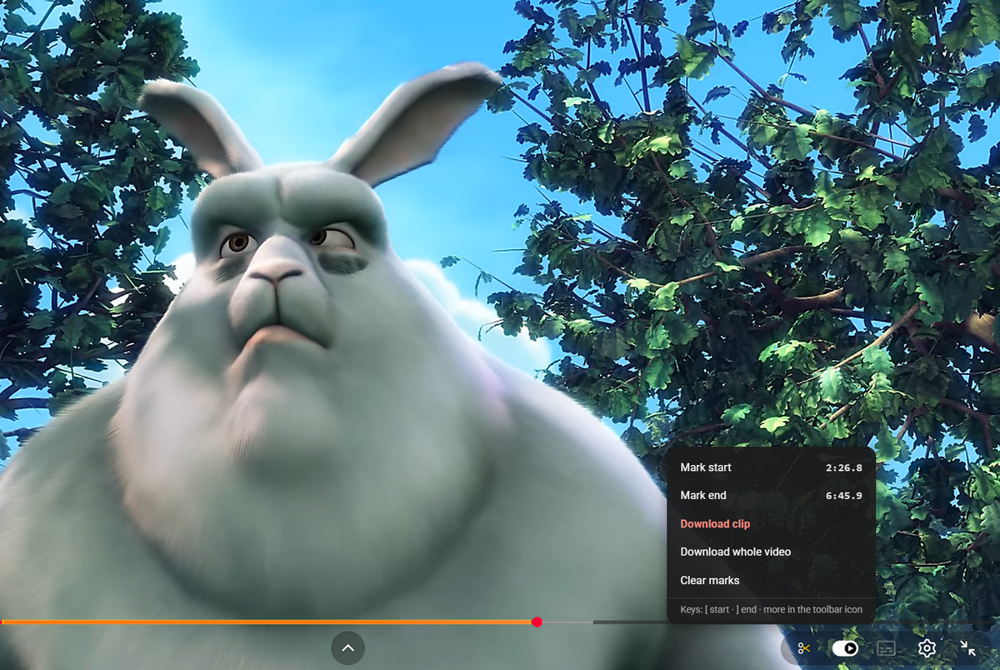
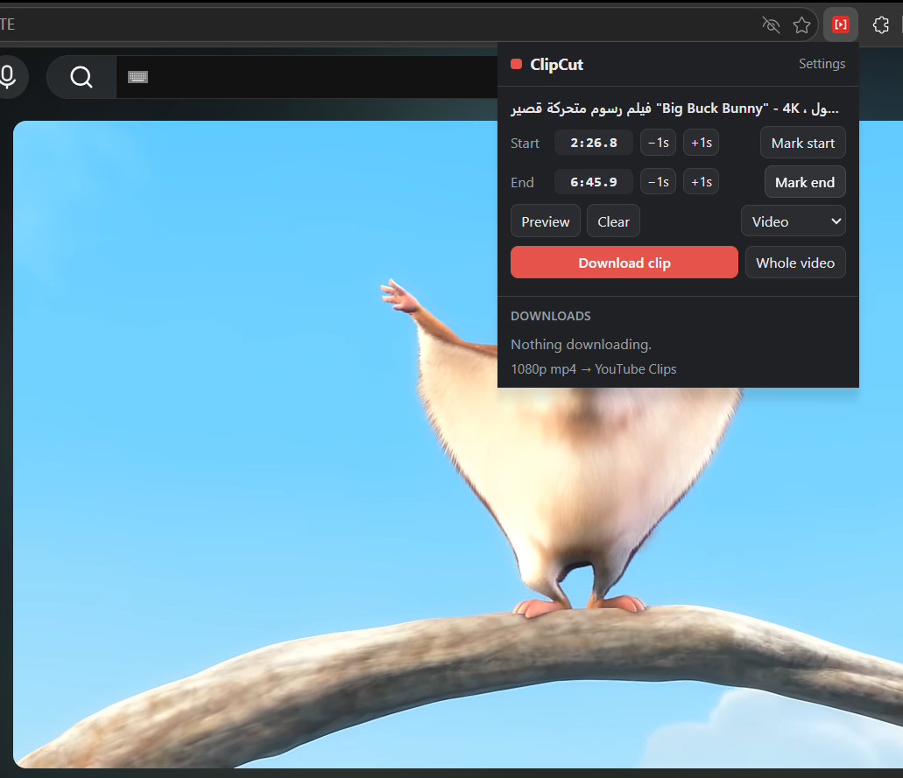
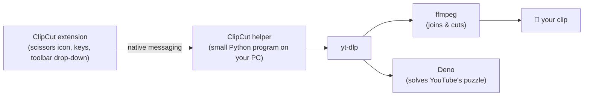

# ClipCut for YouTube

**Mark it. Cut it. Keep it.**

Save just the part of a YouTube video you need, right from the player.
No copying links, no typing times, no download websites.

---

## Why ClipCut?

You're watching a two-hour video and only need four minutes of it. Normally that means copying the link, finding a downloader, guessing timestamps, then trimming the file in an editor.

With ClipCut you press **`[`** where the part starts, **`]`** where it ends, and click **Download clip**. Done. The clip lands in your Downloads folder while you keep watching.

## Features

| | |
|---|---|
| ✂️ **Cut while you watch** | A small scissors icon sits in YouTube's own player bar. Mark start and end with a click, or with the `[` and `]` keys (any keyboard layout, even in full screen). |
| 🎯 **See exactly what you'll get** | The marked part glows yellow on the progress bar. Jump to a mark, nudge it by ±1 second, or **Preview** the clip before downloading. |
| 🎬 **Video or audio** | MP4 or MKV up to 4K, or MP3 / M4A audio only. Optional precise cutting and file shrinking. |
| 📥 **Keeps going in the background** | Leave the page, open other tabs, queue more downloads. Progress shows on the toolbar icon, and a Windows notification tells you when it's saved. |
| 🖱️ **Right-click to grab a whole video** | Right-click any YouTube link → **Download whole video with ClipCut**. |
| 🔐 **Works with your login** | Uses your YouTube sign-in from the browser, so "confirm you're not a bot" isn't a problem. Cookies never leave your PC. |
| 🧘 **Stays out of the way** | No pop-ups and no floating panels. If you're just browsing, all you see is one small icon. |
| ⚡ **Fast and up to date** | Built on [yt-dlp](https://github.com/yt-dlp/yt-dlp), which keeps up with YouTube's changes. ClipCut updates it by itself once a week. |

 The toolbar drop-down: check, nudge or preview your marks, then download.

## Install in 3 steps

> **Needs:** Windows 10 or 11 (64-bit) and Microsoft Edge or Google Chrome.

1. **Download** the latest `ClipCut-for-YouTube-vX.Y.Z.zip` from [**Releases**](https://github.com/GamalOthman/ClipCut-for-YouTube/releases/latest) and extract it.
   *Tip: if Windows warns about files from the internet, right-click the zip → Properties → tick **Unblock** → OK, then extract.*
2. **Double-click `Setup.bat`.** It looks for Python, yt-dlp, ffmpeg and Deno on your PC, uses what's already there, and downloads only what's missing, into your own user folder. No admin rights needed. *(If Windows shows "Windows protected your PC", click **More info → Run anyway**.)*
3. **Load the extension** (first time only). Setup opens the Extensions page and copies the folder path for you:
   turn on **Developer mode** → click **Load unpacked** → paste the path → **Select Folder**.

Open any YouTube video: the ✂️ icon is in the player bar, next to the settings gear.

## How to use it

| To… | Do this |
|---|---|
| Mark the start / end | Press `[` / `]`, or click ✂️ → **Mark start** / **Mark end** |
| Download the marked part | ✂️ → **Download clip** |
| Download the whole video | ✂️ → **Download whole video**, or right-click a video link |
| Check, nudge or preview marks | Click the **ClipCut** icon in the toolbar |
| Watch progress, cancel, see the queue | Click the **ClipCut** icon in the toolbar |
| Change quality, format, folder, notifications | Toolbar icon → **Settings** |

With only a start mark, the clip runs to the end. With only an end mark, it starts at 0:00. Files go to `Downloads\YouTube Clips` unless you pick another folder.

**Live streams:** you can mark while a stream is live (times count from the stream start), but the clip can only be cut after the stream ends. Finished streams work like any other video.

## How it works

Browsers don't let extensions run programs, so ClipCut has two parts. The **extension** reads where you are in the video and keeps the download queue. The **helper**, which Edge or Chrome start in the background, runs [yt-dlp](https://github.com/yt-dlp/yt-dlp) on your PC and reports progress back. Everything happens on your computer.

## Updating

- **yt-dlp:** updates itself about once a week. If downloads suddenly stop working, open **Settings → Update tools**.
- **ClipCut:** download the new release, run its `Setup.bat` (it skips anything you already have), then click reload on ClipCut in `edge://extensions` and refresh your YouTube tabs.

## Uninstall

Run `Uninstall.bat`, then click **Remove** on ClipCut in `edge://extensions`. This deletes everything Setup downloaded, plus settings and the log, from `%LOCALAPPDATA%\ClipCut`. Tools you installed yourself are never touched.

## FAQ

<b>Is it safe? What does it do with my cookies?</b>

ClipCut is open source, so you can read every line. Your YouTube cookies are passed only to yt-dlp on your own PC, in a temporary file that's deleted right after the download. Nothing is sent to any server except YouTube itself.

<b>Why isn't it in the Chrome Web Store or Edge Add-ons?</b>

Store rules don't allow extensions that download YouTube videos, and a store can't install the helper program anyway. That's why ClipCut is installed from this page in developer mode.

<b>Why does Setup download things?</b>

ClipCut needs yt-dlp, ffmpeg, Deno and Python to do the actual downloading. Setup reuses any that are already on your PC and downloads only what's missing, from the official sources (python.org and GitHub releases).

<b>Downloads are slow. Why?</b>

Some networks, especially office networks, inspect or limit large downloads. Try another connection, such as a phone hotspot, to check. ClipCut already downloads several pieces at once.

<b>Mac, Linux or Firefox?</b>

Not yet. ClipCut is Windows-only for now, and works with Edge and Chrome (version 111 or newer).

## Troubleshooting

| You see | Fix |
|---|---|
| "The helper isn't installed" | Run `Setup.bat`, then refresh the YouTube tab. |
| "The helper doesn't accept this extension" | Run `Setup.bat` again. |
| "Missing: yt-dlp / ffmpeg / deno" | Run `Setup.bat` again. |
| "Reload this YouTube page" (in the drop-down) | Press F5 on the YouTube tab. |
| "YouTube's puzzle couldn't be solved" | **Settings → Update tools**. |
| Setup fails while downloading | Your network may block it; try another network and run `Setup.bat` again. |

The helper keeps a log at `%LOCALAPPDATA%\ClipCut\helper.log`. Attach it when you [open an issue](https://github.com/GamalOthman/ClipCut-for-YouTube/issues), after checking that it contains nothing you'd rather keep private.

## Use responsibly

Download only videos you have the right to keep, such as your own uploads, videos whose creator allows it, or content under a free licence. YouTube's terms of service don't allow downloading in general. You are responsible for how you use ClipCut.

ClipCut is an independent project and is not affiliated with or endorsed by YouTube or Google. YouTube is a trademark of Google LLC.

## Credits

ClipCut stands on the shoulders of great open-source projects:
[yt-dlp](https://github.com/yt-dlp/yt-dlp) (Unlicense) ·
[FFmpeg](https://ffmpeg.org/) (GPL build from [yt-dlp/FFmpeg-Builds](https://github.com/yt-dlp/FFmpeg-Builds)) ·
[Deno](https://deno.com/) (MIT) ·
[Python](https://www.python.org/) (PSF License).
Setup downloads them from their official sources; they are not included in this repository.

Screenshots show frames from *Big Buck Bunny* © Blender Foundation ([peach.blender.org](https://peach.blender.org)), licensed under [CC BY 3.0](https://creativecommons.org/licenses/by/3.0/).

## Made with Claude

ClipCut was designed and built with the help of [Claude](https://claude.ai), Anthropic's AI assistant.

## License

[GPL-3.0](LICENSE) © [GamalOthman](https://github.com/GamalOthman)

If ClipCut saves you time, a ⭐ on the repo helps others find it.

